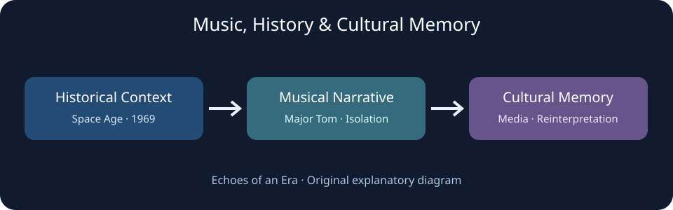
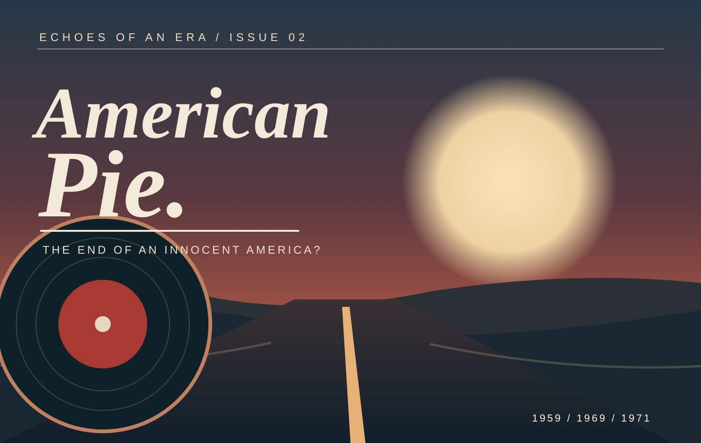
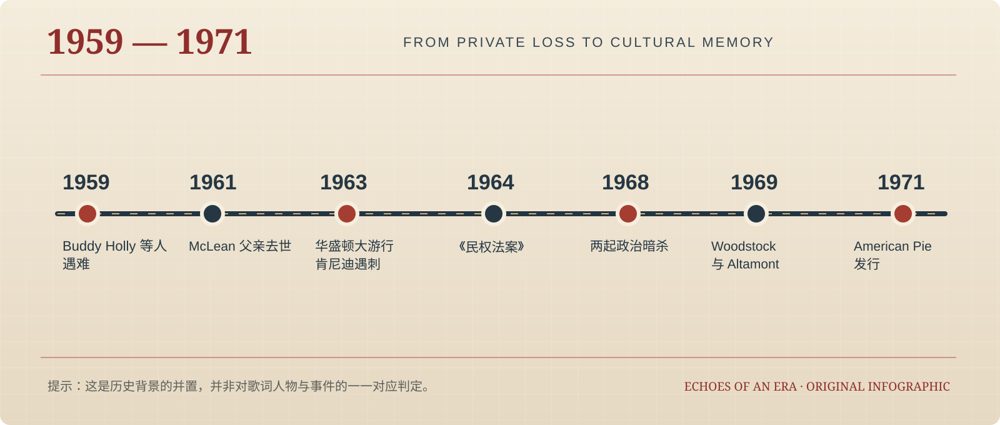

# Echoes of an Era · 时代的回响

> Essays on music, history, culture, and the spirit of an era.  
> 记录那些超越作品本身、成为时代记忆的音乐、电影与文化现象。



## 官方网站

**首页：** https://jim-adak.github.io/Echoes-of-an-Era/

本仓库是持续更新的独立文化杂志与研究讨论稿档案。每个专题同时提供 **图文杂志版** 与 **学术研究版**，前者讲述历史，后者说明论证、证据与局限。

## 已发表的两期专题

| 期数 | 作品 | 图文杂志 | 学术研究 | Markdown |
| --- | --- | --- | --- | --- |
| 02 · 1971 | **Don McLean — American Pie**：当美国开始为自己的青春唱挽歌 | [打开图文特刊](articles/music/1971-american-pie/index.html) | [研究讨论稿](articles/music/1971-american-pie/research.html) | [研究源稿](articles/music/1971-american-pie/README.md) |
| 01 · 1969 | **David Bowie — Space Oddity**：从太空时代的个体叙事到全球文化记忆 | [打开图文特刊](articles/music/1969-space-oddity/index.html) | [研究讨论稿](articles/music/1969-space-oddity/research.html) | [研究源稿](articles/music/1969-space-oddity/README.md) |

## 第二期：American Pie



《American Pie》以1959年Buddy Holly等人遇难为个人记忆起点，把音乐、青年文化与美国社会剧变联系起来。第二期重点讨论：
- 私人悲伤如何被转化为跨世代的文化记忆；
- “1950年代的纯真”是谁的记忆、可能遮蔽谁的历史；
- 歌曲为什么以集体参与感强烈的演唱方式表现失落；
- 对歌词象征的猜测与可验证史料之间有什么界限。



**站点入口：** [American Pie 图文特刊](https://jim-adak.github.io/Echoes-of-an-Era/articles/music/1971-american-pie/) · [American Pie 学术研究版](https://jim-adak.github.io/Echoes-of-an-Era/articles/music/1971-american-pie/research.html)

## 内容原则

1. **事实 / 回忆 / 解释分层。** 历史事件以档案、官方史料或可信研究交叉核验；作者访谈注明年代；主观阐释明确标记。
2. **保留可追溯的参考文献。** 避免把流传广泛的歌词暗号对应表当作已证实的史实。
3. **尊重版权与肖像来源。** 《American Pie》页面的封面及时间线为原创SVG；历史照片使用来自Wikimedia Commons的可用素材并逐图注明来源、许可；不转载完整歌词或商业唱片封面。
4. **承认研究边界。** 研究版是个人讨论稿，不等于已在学术期刊发表的同行评审论文。

## 仓库结构

```text
index.html
README.md
articles/
  music/
    1969-space-oddity/
      index.html
      research.html
      README.md
    1971-american-pie/
      index.html
      research.html
      README.md
assets/
  music-memory-framework.svg
  space-oddity-timeline.svg
  american-pie-cover.svg
  american-pie-timeline.svg
```

## 后续选题

- 《Bohemian Rhapsody》：艺术实验如何成为跨世代文化符号
- 流行音乐中的历史记忆与国家认同
- 电影、音乐与集体记忆的跨媒介传播

---

*Echoes of an Era — 听见音乐，也听见时代。*
