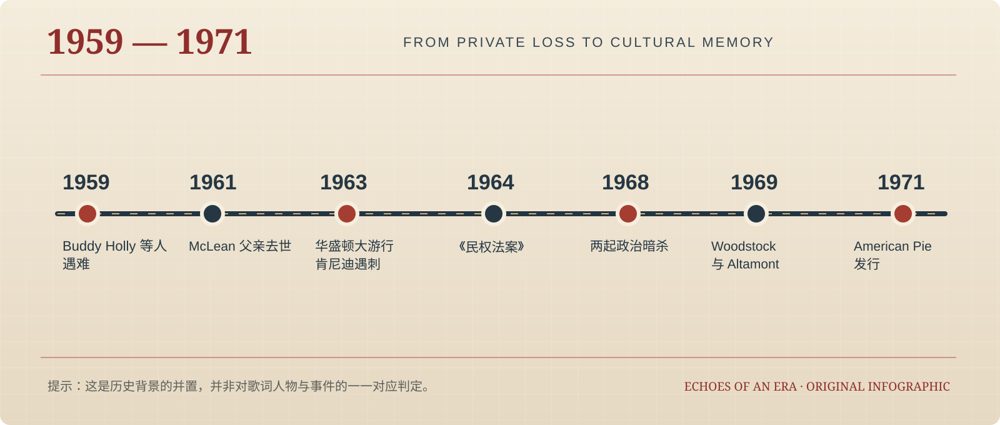

# 从个人创伤到文化记忆：《American Pie》中的美国梦、音乐叙事与1960年代历史变迁

> Echoes of an Era / Vol. 02 · 学术研究版（扩充修订稿）  
> 最后修订：2026-11-09 · **独立研究讨论稿，未经同行评审**

## 摘要

本文以Don McLean的《American Pie》（1971）为个案，考察一首以1959年空难记忆为起点的长篇流行歌曲，如何将私人创伤、战后美国的文化变迁、录音媒介和公共演唱连接成可供跨代际重释的文化记忆。研究综合美国国会图书馆2017年作者访谈、原始创作手稿目录、录音制作人回忆、美国国家档案馆航空事故资料、公开社会史文本与文化记忆理论，采用历史语境分析、文本叙事分析与录音生产史对照的方法。本文认为：歌曲并未宣告摇滚乐作为历史事实的终结，而是把青春安全感的消逝组织成有关“美国”的寓言；乐队合奏、长篇叙事与反复副歌共同赋予悲伤以可共同演唱的形式；作品的持久影响也取决于唱片、广播、机构保存和反复诠释，而非存在唯一的歌词解码答案。与此同时，1950年代的“纯真”具有白人中产阶级经验的特定位置，不能被无条件扩展为所有美国人的共同过去。文章最后提出可检验的听众研究与跨版本音乐分析路线，并区分历史事实、创作者回忆与研究者推论。

**关键词：** American Pie；Don McLean；摇滚乐；怀旧；文化记忆；美国梦；音乐社会学；录音制作史

## 研究范围与证据说明

| 证据类别 | 主要内容 | 使用原则 |
| --- | --- | --- |
| 可核实事实 | 事故、录音日期、榜单、档案与收录 | 以档案、机构记录及制作史交叉核验 |
| 创作者与参与者回忆 | 构思过程、作品意图、录音协作 | 记录说话者和年份，不作为不可质疑的证据 |
| 研究性诠释 | 国家认同、反思性怀旧、合唱共同体 | 提供替代解释，并提出未来检验方式 |

**说明：** 这是一篇以公开史料为基础的定性研究讨论稿；不包含正式乐谱的完整和声分析，也未进行受众问卷。引用文献编号对应文章末尾可追溯的原始网址。未重现受版权保护的完整歌词。

## 一、引言：一首歌如何成为理解一个国家的入口

### 1.1 问题缘起

1971年，Don McLean以一首时长约八分半的《American Pie》进入美国主流音乐史。它以1959年Buddy Holly等音乐人的空难为情感开端，却在随后的叙事中跨越摇滚乐、代际关系、政治动荡、宗教性意象和社会失序。美国国会图书馆对其的介绍将它视为连接1959至1969年一连串意象的作品，并于2016年度将其纳入国家录音登记名录[1]。这一事实首先证明它具有被公共文化机构保存的价值，并不等于其每一种象征都得到了权威解释。

把《American Pie》概括为一首悼念Buddy Holly的歌曲，固然抓住了它的重要起点，却难以解释长篇叙事为何不断引入社会史材料；相反，把它定义为1960年代所有事件的密写年表，又会削弱音乐形式与文学表达的开放性。问题不在于“歌词到底影射了哪位名人”，而在于个人如何借由音乐理解自己所处的时代，以及听众为什么能够把不同历史经验投射到同一首作品中。

### 1.2 研究问题与核心论点

本文关注四个彼此关联的问题：第一，私人创伤如何转换为跨越十年的历史叙事？第二，音乐的结构、演唱方式与制作条件怎样影响作品的感受形式？第三，作品中“失落的美国”究竟是一种可核实的历史事实，还是被选择和重组的文化记忆？第四，作品被反复演唱、翻唱和保存的过程，如何持续改写它对不同代际的意义？

本文提出一个限定性的解释：空难与McLean个人成长史提供情感锚点，长篇叙事与反复副歌提供公共参与的声音形式，社会变革构成可被识别的历史语境，后续制度保存与公众再演绎则使作品成为文化记忆的载体。由此，《American Pie》不是关于“音乐真的死亡”的历史报告，而是对一个世代如何失去确定性、又试图通过共同歌唱重建联系的艺术表达。

### 1.3 研究定位

本研究是基于公开文献和录音制作资料的质性个案研究，位于音乐社会学、美国文化史与文化记忆研究的交叉点。本文不主张提出一套排他的歌词“正确答案”，也不把创作者访谈自动等同于创作时真实的每个心理过程；它尝试说明一种解释何以有根据、何处必须保持开放。

## 二、研究史与理论框架：怀旧、记忆和国家叙事

### 2.1 三种既有研究路径及其不足

关于《American Pie》的公共讨论大致有三条路径：一种从1959年空难与McLean的生平出发，强调自传性；另一种把歌词中的人物、舞蹈、宗教和音乐意象与1960年代著名事件逐项对应，追求破解隐喻；第三种从作品的长篇形式、广播传播和公共文化地位入手，关注它为何成为流行文化经典。Christie’s于2015年公开讨论手稿时，明确把作品称为具有寓言性质、而非供猜谜的文本[4]。这提醒我们，逐句对应虽有吸引力，却无法单独构成充分的学术解释。

这三种路径并非相互排斥。传记研究可以确认历史起点，歌词阐释有助于识别语义网络，录音与传播研究则能解释作品如何被听见。但若只选其中一种，便容易把作者、文本与公众混为一谈。本文试图把它们放入“创作语境—声音组织—媒介传播—记忆再生产”的连续框架。

### 2.2 哈布瓦赫：记忆从来具有社会框架

Halbwachs强调个体回忆受到群体生活和社会情境的塑造，集体记忆具有选择性，不同社会群体可能记住不同的过去[9]。这一点既可解释McLean为何将个人少年经验放进特定的美国音乐文化中，也可提醒我们：对白人中产阶级听众来说富有温情的1950年代，对于在种族隔离和排斥中生活的人而言，并不具有同样的意义。

在这里，“集体记忆”并非所有人脑中装有同一幅历史画面，而是某些人通过歌曲、唱片、广播和公共讨论共享了一组关于过去的参照。公众的共同唱和可以形成暂时性的归属体验，但不能据此推断全体听众的社会立场完全相同。

### 2.3 Boym：复原性怀旧与反思性怀旧

Boym在《怀旧的未来》中讨论了试图重建确定故乡的复原性怀旧，以及更重视时间裂缝、承认返回不可能的反思性怀旧[11]。将这一框架用于《American Pie》，可以构成一个有解释力的假设：歌曲并不是在提出把美国带回1950年代的政治计划，而是在把“过去为什么已经无法回来”的感受转化为可反复演唱的叙事。

这仍是一种理论上的比照，不能将Boym的术语归给McLean本人。尤其重要的是：反思性怀旧并不自动具有进步性。追忆可以促使人质疑被美化的过去，也可以在特定语境中重新巩固被美化的叙述，最终方向必须结合听众接受与传播环境判断。

### 2.4 Assmann和Anderson：从日常交流到文化典范

Assmann区分基于日常交谈的交流记忆与依赖持久文化载体的文化记忆，强调文献、仪式和反复的社会实践对过去的保存作用[10]。歌曲最初对应创作者与同代人的近期经验，后来借唱片、档案与演出进入更长的文化时间尺度，正适合从这个差异出发分析。需要注意：录音被保存并不意味着社会就存在单一固定版本的意义。

Anderson的“想象的共同体”主要研究民族共同体形成机制，不能直接当作流行歌曲的因果理论[12]。本文只借用其有关分散个体如何在共享媒介与时间想象中形成联结的启发：在不同地点听同一首歌的公众，可能在某个瞬间想象自己正参与一段共同的历史。这个假设有助于提出问题，但若要证明听众真的形成国家认同，还需要实际的接受史证据。

## 三、资料、方法与证据可信度

### 3.1 资料分层与交叉核验

第一层是可查证的事件与物质资料：美国国家档案馆关于1959年航空事故报告的馆藏说明、1971年录音制作人的技术回忆、英国官方排行榜和美国国会图书馆录音登记信息[6][3][14][1]。它们能够支持时间、录音地点、传播和机构保存等事实。

第二层是创作者与参与者的回顾：2017年国会图书馆访谈、McLean官方网站说明、制作人Ed Freeman和工程师Tom Flye在2012年的采访，以及2015年原始手稿公开材料[2][5][3][4]。这些信息彼此可以对照，但回顾性叙述可能受到记忆偏差、事后解释或宣传情境影响。

第三层是研究者应用理论的阐释：对叙事时间、公共合唱、选择性怀旧和国家认同的判断。它们需要依托第一、二层材料提出可辩驳的论证，不能与证实过的历史事件写成同一语气。

### 3.2 采用的方法

历史语境分析追踪1959年至1971年间与歌曲有关的音乐史和社会变化，但不将每一件大事强塞进歌词；叙事分析识别第一人称回忆、时间跨度、象征性场景、重复段落与情绪转向；音乐制作史分析利用录音参与者资料考察编曲与媒介条件；文化记忆分析聚焦制度保存与重新演绎如何参与作品意义的延续。

本文并未取得母带分轨、正式乐谱和大样本听众访谈。因而，对调性、精确和声、节拍变化及情绪的断言会加以限制；对合唱行为的讨论属于有依据的机制性解释，不被表述为已经通过实验验证的心理因果关系。

### 3.3 关于歌词引用与阐释原则

《American Pie》歌词仍受版权保护，本文仅讨论作品结构和意象类型，不复制歌词全文或逐节逐句翻译。对任何“人物=某位歌手”的猜测，先追问：是否有创作者在可追溯资料中明确证实？是否有创作手稿或录音证据支持？是否存在多种同样合理的解释？若不能通过这一检验，应将其标为推测，而不是历史事实。

作者本人在2017年采访中表示，最初的叙事起点与Buddy Holly及空难确有关联，但他一贯拒绝披露每一处歌词的“含义”，并描述了希望借音乐与政治平行前进来书写美国的初始构想[2]。这为研究提供了一个难得的作者阐释边界。

## 四、1959年的空难：悲剧如何被编入一代人的成长史

### 4.1 事故与历史事实

1959年2月3日，一架Beech Bonanza在艾奥瓦州Mason City附近坠毁，Buddy Holly、Ritchie Valens、J. P. Richardson（The Big Bopper）以及飞行员Roger Peterson遇难。美国国家档案馆明确列出该事故的民航委员会报告编号2-0001，报告于1959年9月23日发布，并标明馆藏位置[6]。因此，准确的事实层面是“几位重要音乐人遇难”，而非“摇滚音乐在这天停止发展”。

后来常见的“音乐死去的那一天”，是作品对事件的艺术命名。名字之所以有力量，正因为它把有限的事故扩大为无形的时代断裂。研究必须区分由事故带来的真实生命损失与由作品赋予它的象征性历史后果。

### 4.2 报童、父亲与肯尼迪：私人时间的多重断裂

McLean官方网站把1959年做报童时看到的报道、1961年父亲去世和1963年肯尼迪遇刺连接在一条童年结束的时间轴上[5]。这种排列传达了一个重要事实：歌曲的悲伤不仅针对Buddy Holly一人，音乐事件与家庭、国家政治经验在回忆中相互交织。

但回顾性生命故事也有结构化效应。一个人多年后讲述自己的创作，很可能把零散经历组织成看起来连续、必然的成长轨迹。我们可以利用这些自述理解作者如何认识作品，却不能据此证明每一位1971年的听众都按同一顺序体验历史。

### 4.3 成文并非一次完成：从私人开场到寓言整体

2017年国会图书馆访谈中，McLean说明自己在纽约州Cold Spring一处gatehouse写出开头，约一个月后完成副歌，其他部分写于宾夕法尼亚州Chestnut Hill；他还回忆首演时曾请台下一名女孩帮忙举歌词，初次现场反响并非立即热烈[2]。这样的细节尤其重要：它显示作品经历分段发展和表演检验，而不是在某次强烈灵感中形成完整、封闭的密码系统。

手稿的后世展出与拍卖进一步表明，作品存在草稿、修改及删节过程[4]。手稿证据支持“多次加工的艺术构造”，但公开拍卖目录没有授权我们把每项改动都解读为作者在某日针对某次历史事件作出的选择。

## 五、1950年代的美国梦：繁荣、摇滚与排除机制

### 5.1 白人中产阶级的经济与文化安全感

二战后的美国经济增长、汽车普及、郊区住宅建设、电视媒介和青少年消费市场扩张，共同塑造了1950年代美好生活的典型图像。在McLean的回顾中，这是一种充满希望与家庭稳定感的时代印象[5]。将它作为个人记忆来研究，能帮助解释为什么音乐与成长经验会紧密联系。

然而，经济指标或消费习惯不能直接代表整个国民的生活状况。退伍军人福利、住房市场和就业结构的实际利益分配存在种族与性别差异；“繁荣的美国”常是某些群体能够享受的社会条件，而非超越身份差异的普遍现实。研究1950年代的怀旧，必须同时说明这种记忆的阶层位置。

### 5.2 摇滚乐不是单一群体的创造物

早期摇滚乐深受非裔美国人的节奏布鲁斯、福音传统与跨族群商业音乐交流影响。Chuck Berry、Little Richard、Fats Domino等人物与Buddy Holly、Elvis Presley一起构成不可分割却常被市场分隔的音乐史。若叙述只展示白人明星的“纯真年代”，便可能在怀旧中再次遮蔽摇滚乐本身的跨族群来源。

这种遮蔽并不意味着McLean有意否定其他音乐人的贡献，而是提示文本意义和历史社会结构不完全重合。歌手写的是自己能记住的过去；研究者必须把这个被记住的过去放回更广泛的社会史中。

### 5.3 怀旧并不是历史证词的替代品

对1950年代“稳定”的回望往往同时压缩了家庭矛盾、冷战核焦虑、麦卡锡主义氛围和持续的民权抗争。歌曲可以真实表达创作者当年的安全感，却不能由此证明那个年代客观上没有危机。文学表达的真实性与社会事实的普遍性应分别判断。

因此，本文将“黄金年代”作为被建构的记忆对象，而非先验的历史分期结论。我们真正关心的是：为何在经历了1960年代的重大变革之后，早年的音乐能成为衡量时代变化的感情标尺？

## 六、1960年代：混乱与解放并存的公共历史

### 6.1 民权运动：秩序的挑战不等于进步的失败

1963年华盛顿大游行、1964年《民权法案》及其后围绕投票权和制度平等的改革，表明1960年代存在明确的社会解放过程。《The American Yawp》的修订版第25章也强调，这一时期同时包含对更包容社会的希望与沉重的冲突[7]。将这些变革简单描述成“美国不再纯真”，容易把旧秩序的稳定与公共正义混为一谈。

从一个白人中产阶级少年回忆的角度，熟悉的社会世界可能显得破碎；从长期遭遇种族隔离的人群角度，原有“秩序”本身就是必须克服的不平等。二者形成一种真实而不可轻易调和的历史张力。它要求读者区分情绪上的失落和规范意义上的退步。

### 6.2 战争、政治暗杀与信任危机

越南战争把美国的军事权力、媒体报道和公共信任推向激烈争论。1968年春节攻势、反战动员、芝加哥民主党大会前后的冲突，以及马丁·路德·金和罗伯特·肯尼迪遇刺，构成1960年代末社会焦虑的重要背景[7][8]。这里的关键词并不只是“动荡”，而是不同群体对政府可信度和国家道德形象的评价发生了分化。

McLean在2017年访谈中清晰表示，他创作时想让音乐和政治像并行的线索那样前进[2]。这一材料支持将《American Pie》放入政治史背景，而无需冒险宣称某一个歌词角色必然等于某位政治领袖。

### 6.3 Woodstock与Altamont：一个方便但危险的对照

1969年8月的Woodstock和12月的Altamont经常被视为反文化梦想的两面。Altamont现场组织失当及发生的致命暴力为这一对照提供了真实依据。《The American Yawp》修订版第26章以二者作为讨论1970年代政治文化变化的开端[8]。

不过，“Woodstock代表理想、Altamont代表理想死亡”仍是后见之明的叙事压缩：Woodstock并非没有矛盾，Altamont也不能覆盖所有反文化参与者的经验。把两个事件作为社会矛盾的象征是可以接受的，把它们当作全部1960年代的命运总结则证据不足。

### 6.4 美国梦的意义分化

所谓美国梦，并非一份所有时代、所有群体都同意的固定清单。它可能意味着中产阶级家庭稳定、商业成功、个人自由、种族平等、免于战争或参与公共决定的权利。1960年代并不是“一个共同的美国梦被共同失去”，而更像是许多相互竞争的美国梦被迫同时进入公共讨论。

因此，作品所表达的分裂具有解释力，但若从历史角度考察，必须继续追问“谁的梦想”“谁失去什么”“谁获得了以前没有的选择”。这种反向阅读不会削弱歌曲的艺术价值，反而让其怀旧情绪获得更复杂的社会学意义。

## 七、文本叙事：私人回忆怎样构造历史寓言

### 7.1 非线性时间与回望视角

《American Pie》并不是严格按照年份报出历史事件的编年史。作品从个人记忆进入更开阔的群体和历史场景，时间层次发生叠置。听众感受到的是叙述者回顾往昔时不断增强的不确定性，而不是一份能够逐项打勾的年代表。

这种时间结构具有双重效果：私人记忆为抽象时代赋予情感浓度，国家背景又反过来放大个体失落的意义。历史在文本中不是纯粹背景板，而是被回忆重新排列的对象。

### 7.2 叙述者、群体和语气的变化

开场的第一人称叙述把听众放在相对可辨认的经验场景中；后续不断出现的集体、仪式和象征性人物，则扩大了叙事的社会范围。二者之间并无简单的等号：歌中的“我”不必在每个瞬间都和作者本人完全重合，象征性人物也不必都能落实到某个真实的人。

把声音主体区分为“经历者”“回忆者”和“向公众讲述者”，有助于观察同一首作品的叙事张力。前者的经验是局部的，后者的讲述却试图为一个时代寻找意义；二者的尺度差，恰是这首作品适合进入文化研究的原因。

### 7.3 重复段落不是多余，而是情绪的锚点

副歌每次返回时，听众已经历了新的叙事信息。文字上相似的回返，在音乐结构中不必产生完全相同的意义：它既唤回最初的丧失，也把后续社会场景纳入同一套情绪语汇。

从叙事学角度看，重复具有记忆标记功能；从演唱实践看，它降低公众参与的门槛；从媒介传播看，它又让一首文字密度很高的长歌具备被熟记的核心段落。这里应当强调这是基于形式与传播条件的合理推论，具体听众是否产生相同情绪需要独立证据。

### 7.4 为什么不应把歌词读成“名人密码表”

公众关于歌中象征人物的猜测可以作为接受史材料：它们显示听众愿意将1960年代文化人物投射进作品。但是，网络流传的答案常缺乏可追踪的创作者证实，存在同一句被解释为多个互不相同人物的情况。只讨论对应表，容易把诗性模糊误当待解的技术错误。

2015年原稿公开和2017年访谈说明，McLean曾经尝试留下“关于美国”的大型寓言而非一份公开索引[4][2]。学术讨论可以提出可能的历史联系，却必须说明替代解释为何较弱、证据链能走到哪里，并坦率承认文本没有提供唯一结论。

## 八、录音与音乐形式：长篇民谣如何获得公共感染力

### 8.1 录音史提供了罕见的声音证据

2012年《Sound on Sound》对制作人Ed Freeman和录音工程师Tom Flye的采访，提供了比一般音乐评论更细致的制作信息：正式录音于1971年5月26日在纽约Record Plant的Studio A进行；Freeman要求乐队排练约两周，以获得能够真实互动的整体演奏，而McLean起初更偏向于简单的原声吉他演唱[3]。

在这一制作视角下，《American Pie》不是“一个创作者唱了八分钟歌词”那么简单。即使歌词拥有强烈的个人自传色彩，最终录音也有制作人与伴奏者的共同选择：它需要在长篇叙事中持续维持速度感、情绪连贯性和听众注意力。

### 8.2 乐队现场感与“自然”并不是未经制作

Freeman更希望录得一支真正彼此互动的乐队，而非完全依靠分散叠录的机械拼接。录音工程师说明，McLean演唱时同时弹奏原声吉他，其他乐手在录音室合奏；同时，最终人声经过多轨组合，钢琴引子也使用了剪辑[3]。

因此，听起来像自发聚会、讲故事或共同唱和的效果，并不意味着制作过程毫无设计。恰恰相反，声音中的“自然”“现场”和“亲近”可能是技术、排练、剪辑和表演协商的结果。这提醒研究者：流行歌曲的真诚感既来自表达，也来自录音形式如何组织听众的听觉期待。

### 8.3 旋律与编曲的三段式感知机制

从可听见的整体形态出发，作品可以暂按分析目的分为三个功能性层次，而不把它误认成官方乐谱分段。第一层是较私人化的叙事开端，文本信息和讲述感较突出；第二层是不断出现的可识别副歌，使长篇内容具有共同回返点；第三层是多节叙事的累积与不同声部加入后形成的群体性推动。这种层次区分用于说明听觉功能，不等于测量了每一节精确时值。

相对于只利用和弦循环支撑的短篇流行歌曲，《American Pie》的特殊难题在于：如何让密集、隐晦、不断变化的文字与稳定、可参与的音乐保持平衡。叙事段落携带陌生感，副歌提供熟悉感；两种力量共同构成歌曲可反复聆听的重要条件。

“情绪由哀伤转为庆典”是一种听觉上的概括，不应被当成客观测得的情感轨迹。若未来补入谱例、音频分析以及多位听众报告，才可进一步检验节奏、配器密度、和声和演唱语气如何分别影响感受。

### 8.4 八分半的篇幅与双面单曲的媒介限制

《Sound on Sound》的制作史指出，当年的45转唱片不得不把作品分置两面，时长分别约为4分11秒和4分31秒。这样做反映了广播与唱片工业对流行歌曲长度的限制，而不是单纯的艺术趣闻[3]。歌曲最终在1972年达到美国单曲榜冠军，在英国官方单曲榜达到第2名[15][14]。

这使《American Pie》成为一个很有价值的媒介案例：它通过高度可记忆的旋律结构，让对电台来说异常冗长的叙事进入主流传播。但不能由此反推“作品越长越成功”；它是在特定电台环境、唱片工业和创作者声望条件下获得关注的例外。

## 九、从歌词的哀歌到听众的合唱：社会参与的悖论

### 9.1 哀伤与参与并存

一首具有挽歌性质的作品为什么可以成为聚会中的集体合唱？关键可能在于它同时提供两种行为位置：听众可以作为旁观者聆听个人故事，也可以作为参与者进入熟悉的重复段落。这并不消除歌词的失落，反而使失落以一种可被共同承担的形式出现。

制作史中的群体演奏倾向，以及Christie’s手稿介绍里对作品作为公共合唱经典的讨论，为这种解释提供了形式与接受层面的线索[3][4]。但请注意，它们不是严格的行为实验，无法证明合唱必然会产生同质的共同体认同。

### 9.2 暂时的共同体与不一致的政治立场

参加同一场合唱的人，可能分别将歌曲理解为对Buddy Holly的哀悼、对青春的告别、对越战的批评，或者仅仅是对熟悉旋律的享受。共同参与不要求意义完全一致，反而可能依赖作品开放的象征范围。

这一特征让作品适合成为文化记忆载体：它既具辨识度又能容纳分歧。所谓“集体记忆”在这里并非思想统一，而是围绕若干共同符号形成可持续争论和重新定位的公共场域。

### 9.3 可检验的后续研究方案

为了验证“共同歌唱加强归属感”的假设，可以比较三组情境：独自耳机聆听、观看现场视频、参加现场共同合唱。通过半结构访谈与简短感受量表，询问听众对历史联想、悲伤程度和群体联结的理解，并记录年龄、文化背景与对1950年代历史的知识差异。

如果不同情境下的听众均无法观察到任何可区分的归属感变化，那么本文关于演唱共同体的解释就应当被修正。能够明确提出可反驳条件，才使这一观点不仅停留在抒情表述。

## 十、媒介流通：从1971年的唱片到文化典范

### 10.1 发行和广播机制

McLean官方网站记载，录音于1971年5月26日完成，同年作品逐步获得广播曝光，双面单曲于1971年11月发行，1972年登上美国单曲榜冠军[15]。制作人和工程师的访谈也提到45转唱片的分面方案，以及唱片中不中断的完整版本有助于听众体验整体叙事[3]。

这一传播过程说明作品的文化影响既不能归于纯粹的写作才华，也不能简化为行业营销。唱片技术、FM电台对长作品的容纳、制作人与表演者的协作，以及口耳相传和后续演出，共同塑造了歌曲跨越小众民谣与主流流行市场的通道。

### 10.2 榜单成绩与文化影响应分开衡量

英国官方榜单显示《American Pie》在1972年初进入英国单曲榜，最高位次为第2[14]；美国成绩可由唱片官方历史及同期制作史材料核对[15][3]。排行榜说明了特定市场的流通规模，却不能单独证明听众以何种思想理解文本。

一个作品可以畅销而没有深层公共争论，也可能没有商业成功却在小群体内具有强大文化意义。因此，本研究把榜单当作传播背景指标，把评论、再演绎和机构保存当作文化记忆进一步发展的不同环节，避免将销量等同于艺术价值。

### 10.3 国家录音登记与2015年手稿：制度化记忆

《American Pie》被选入美国国会图书馆2016年度国家录音登记名录，体现了公共保存制度对这份录音的历史文化价值认定[1]。2015年Christie’s公开原始创作手稿及其修订痕迹，又使原本借听觉传播的流行作品获得可被收藏、展示与研究的文献身份[4]。

这里出现一个重要转变：初期听众接触的是播放中的歌曲；后来的研究者还能够处理录音工程师的回忆、草稿版本、唱片版本和文化机构的文本。作品因此不仅被听见，也被编目、保存、展陈，并持续成为历史讨论的对象。

### 10.4 跨时代重释不是对原意的背叛

歌曲在不同时期被翻唱和引用时，某些听众可能更看重传唱性，另一些人则更在意政治寓言。McLean在2017年访谈中认为，作品的关注度不断返回，但他不愿把歌词含义彻底固定[2]。这种开放性并不意味着任何解释都同样正确，而是表示作品意义同时受到文本条件和接受语境约束。

研究跨代际传播，最需要的并非不断夸大歌曲“永恒”的价值，而是建立可检验的时间序列：1971—1972年媒体如何谈它，2015年手稿讨论如何重读它，2017年机构保存如何框定它，21世纪不同文化听众又怎样将其纳入自身记忆。

## 十一、对“美国梦消亡”的反向解读

### 11.1 谁在失去，谁在获得？

“美国梦消亡”的说法有较强的修辞吸引力，但可能掩盖群体位置。对于把1950年代家庭稳定与国家自信当作常态的人，1960年代的政治冲突显得像是秩序崩溃；对于受种族隔离制约、要求制度性权利的人，旧有秩序的松动恰是另一种美国梦实现的条件。

因此，本文不把“失落”直接等同于“社会退步”。作品呈现的危机可以是真的，但其感情代表性不能未经证明就扩展为全国共识。这种读法并非以今天的价值观抹消当年的艺术经验，而是在辨认经验所处的位置。

### 11.2 种族与音乐史中的记忆偏差

早期摇滚乐市场对非裔创作者与白人歌手采取了不同的推广路径，后世经典叙述也可能倾向以少数白人明星作为整段历史的门面。如果《American Pie》的听众把1959年空难理解为“整个音乐的死亡”，他们实际是在将某些音乐经验放在最显眼的位置，而不是宣布所有音乐创造活动停摆。

这一不均衡可以成为未来比较研究的起点：选取同一时期不同族群音乐人的唱片与电台记录，分析哪些音乐作品进入主流怀旧叙述，哪些长期留在社会记忆边缘。本文没有完成这项系统研究，因此目前把它作为批判性问题，而非对McLean个人动机的判断。

### 11.3 性别、阶层与地理尺度

美国梦在乡村、郊区、工业城市、大学校园和少数族裔社区中有不同内容。一个以成年男性摇滚听众为中心的叙事框架，未必能充分反映家庭照护、女性职业权利和移民生活的经验。

因此，宏大的国家寓言总带有代表性风险。歌曲可以作为理解一个时代的有力入口，却不能取代多元群体的口述史、社会统计与地方档案。

### 11.4 两种容易滑向极端的误读

第一种误读是把《American Pie》写成“过去完美、现在衰败”的政治宣言；第二种则是因为作品存在怀旧情绪，就认为其全部历史感受缺乏正当性。两种解释都过于简单。怀旧有时遮蔽不公，有时也为人表达生活世界骤变的创伤。

更合适的结论是：歌曲让失落得到令人信服的艺术形式，而历史研究必须继续检查这种失落的对象、范围与叙述位置。艺术真实性与历史论证可以相互激发，但不能互相替代。

## 十二、综合模型：创作、声音、传播与记忆的四层机制

### 12.1 从一首歌到公共记忆的路径

结合前述材料，可以提出如下分析模型。第一层是创作语境：1959年空难、个人家庭经验及1960年代政治氛围为创作提供资源。第二层是文本与声音：长篇叙事把经验联结成具有时代色彩的寓言，副歌回返与乐队编曲给予听众参与空间。第三层是传播机制：广播、唱片形式、榜单、现场演唱使作品在社会中不断出现。第四层是记忆再生产：手稿收藏、公共登记、评论与跨时代聆听使它成为可重新阐释的文化参照。

这不是一个严格单向的公式。后来的讨论可能反过来改变听众理解早期历史的方式；已有的社会记忆也会影响人们重新收听录音时重视哪些部分。所以模型更接近一个反馈系统，而非创作者“决定意义”、媒介“机械传播”、公众“被动接收”的直线过程。

### 12.2 四个可反驳命题

命题A：如果听众知道1959年事故，便更可能把开头听作个人悼念；这一判断可以通过分组访谈比较有无背景信息的聆听者来检验。命题B：副歌回返使不熟悉全部隐喻的听众仍可参与演唱；可以比较副歌识记率与叙事段落识记率。命题C：不同代际对“美国梦”象征的理解存在系统差异；可以对不同出生年代的人进行主题编码。命题D：机构性保存增加作品的可见度，但不会产生统一解释；可比较登记前后的评论文本与主题分歧。

这些命题并没有在本稿中得到实证检验。提出它们的目的，是明确界定下一步何种资料可能支持、修正或否定本文的解释。

### 12.3 与《Space Oddity》的初步比较

如果把本专题放进《Echoes of an Era》的连续研究，《Space Oddity》与《American Pie》形成互补：前者常被从1969年太空想象、技术现代性与个体孤独理解，后者则更多从内在历史回望、美国梦与失落的集体记忆入手。两者都显示，特定的事件语境可以为作品赋予超出作者原始意图的公共意义。

不过，两首歌的作者国籍、发行环境、叙事结构与媒介联系各异，不能仅凭两例便推出“西方流行音乐普遍比其他文化更能承载时代”的结论。跨文化比较需要明确的样本原则、语言能力与可比较指标。

## 十三、结论与后续研究路线

### 13.1 主要发现

本文认为，《American Pie》的意义并不能被压缩成“1959年三位音乐人的悼词”，也不能被当作一份完全有标准答案的1960年代事件索引。作品通过可追踪的私人记忆起点、分段形成的长篇寓言、精心组织的录音形态以及反复出现的副歌，把对一个年代的矛盾感受转化为能够被共同聆听和不断争论的文化形式。

历史分析进一步表明，歌曲对1950年代安全感的追忆是真实而重要的情绪资料，但不能据此断言那个年代对所有社会群体都公平、安定；对1960年代社会危机的感叹也不能抹去民权运动等带来的制度改进。文化记忆之所以值得研究，正因为它既保存了经验，也对经验进行了选择。

### 13.2 研究局限

第一，本稿主要依赖公开访谈、唱片制作史、手稿目录与历史教材，尚未系统检索1971—1972年的同期报刊、电台档案和评论。第二，未取得分轨母带与正式谱例，音乐结构分析仍处于听觉形态与制作史层次，不宜用来证明精确和声、动态和情绪效应。第三，缺少跨代际与跨文化听众访谈，因此“共同体感”的论述是理论性机制假说。第四，作者官方资料和友人撰写的文章可能有自我解释与赞誉倾向，已在论证中与独立史料分开对待。

最后，本文并非已完成同行评审的学术成果。理论概念虽参考了相关著作，但没有使用足够系统的国内外学术文献计量和书目检索，文献综述应视为初步研究地图，而非声称覆盖了全部既有成果。

### 13.3 可以真正落实的拓展工作

未来建议按三个可执行步骤展开。首先，整理1971—1972年同期唱片评论和广播材料，建立按发表时间排序的接受史档案。其次，选取1971年原录音与少量具有代表性的现场版本，记录时间码、段落、乐器加入与力度变化，制作可复核的形式表，而不是只凭印象判断音乐“越来越激昂”。最后，开展小样本访谈，比较不同年龄、文化背景和政治立场的听众对1950年代与“美国梦”的联想。

《American Pie》的研究价值并不在于提供对美国历史的最后裁决，而在于展示一首歌如何让个人失去、社会动荡和国家想象在同一个声音结构中彼此交锋。艺术能够使过去被重新感受；历史研究则要求我们追问，被感受的过去如何形成，以及谁的经验仍被留在声音之外。

## 参考文献

[1] Library of Congress. 2016 National Recording Registry: American Pie — Don McLean (1971). https://www.loc.gov/programs/national-recording-preservation-board/recording-registry/registry-by-induction-years/2016/

[2] Library of Congress. Interview with Don McLean, April 13, 2017. https://www.loc.gov/static/programs/national-recording-preservation-board/documents/DonMcleanInterview.pdf

[3] Buskin R. Classic Tracks: Don McLean 'American Pie'. Sound on Sound, March 2012. https://www.soundonsound.com/techniques/classic-tracks-don-mclean-american-pie

[4] Christie's. Don McLean: The Complete Working Manuscript for the Song 'American Pie' (1970–71), lot 5885030, 2015. https://www.christies.com/en/lot/lot-5885030

[5] Don McLean. About American Pie, July 11, 2019. https://donmclean.com/about-american-pie/

[6] U.S. National Archives. Aircraft Accident Reports, including CAB Report No. 2-0001 on the crash near Mason City, Iowa, Feb. 3, 1959. https://www.archives.gov/research/transportation/aircraft-accidents

[7] The American Yawp. Chapter 25: The Sixties, updated textbook edition. https://www.americanyawp.com/textbook/25-the-sixties/

[8] The American Yawp. Chapter 26: The Unraveling, updated textbook edition. https://www.americanyawp.com/textbook/26-the-unraveling/

[9] Halbwachs M. On Collective Memory. Edited and translated by L. A. Coser. Chicago: University of Chicago Press, 1992. https://press.uchicago.edu/ucp/books/book/chicago/O/bo3619875

[10] Assmann J, Czaplicka J. Collective Memory and Cultural Identity. New German Critique, 1995(65):125–133. DOI:10.2307/488538. https://doi.org/10.2307/488538

[11] Boym S. The Future of Nostalgia. New York: Basic Books, 2001. (Paperback edition 2002). https://www.hachettebookgroup.com/titles/svetlana-boym/the-future-of-nostalgia/9780465007080/

[12] Anderson B. Imagined Communities: Reflections on the Origin and Spread of Nationalism. Revised edition. London: Verso, 2006. https://www.versobooks.com/products/1126-imagined-communities

[13] Case Western Reserve University. The Day the Music Died: How Don McLean's 'American Pie' Immortalized a Tragedy, Feb. 2, 2024. https://case.edu/news/day-music-died-how-don-mcleans-american-pie-immortalized-tragedy

[14] Official Charts Company. Don McLean — American Pie: Official UK Singles Chart history. https://www.officialcharts.com/songs/don-mclean-american-pie/

[15] Don McLean. About (official biography; recording and release of American Pie). https://donmclean.com/about/

## 编辑说明与下一步证据缺口

- 2017年国会图书馆访谈直接支持创作地点、成文顺序及音乐与政治并行的构思；并不证明所有具体歌词的象征指向。
- 制作史记录支持1971年5月26日Record Plant的录音及双面单曲分割，但“合唱产生共同体感”仍属于研究假设。
- 美国国家档案馆页面是事故报告的馆藏导航，不可误认为本文已逐页核验原始航空事故报告扫描件。
- 2015年佳士得拍卖目录证明手稿与修订存在；未对全部手稿逐页做校勘。
- 理论著作用于构建分析框架，不能替代关于1971年听众的同期证据。
- 下一步应补入1971—1972年报刊与电台资料、音频时间码表和不同代际受众访谈。

## 版权与项目来源

本稿不提供《American Pie》完整歌词与未经授权的商业封面复制。图表为本项目原创，网页展示的音频资料请通过文献链接自行访问。本专题的[杂志版](index.html)与[研究版](research.html)彼此独立，杂志版保持原样。
